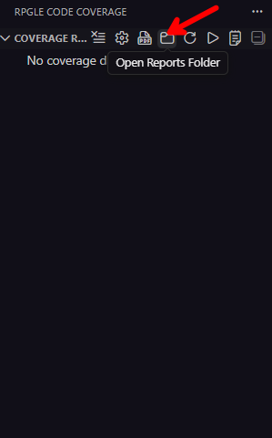
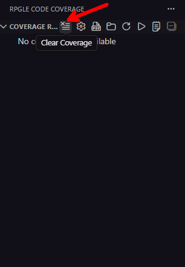

# Frequently Asked Questions (FAQ)

Quick answers to common questions about RPGLE Code Coverage.

## General Questions

### What is RPGLE Code Coverage?

RPGLE Code Coverage is a Visual Studio Code extension that provides code coverage analysis for RPGLE and SQLRPGLE programs on IBM i systems. It helps you identify which lines of code are executed during tests and which are not.

### Is it free?

Yes! RPGLE Code Coverage is completely free and open source under the MIT license.

### Which IBM i versions are supported?

- IBM i 7.3 (with PTF SI80728)
- IBM i 7.4 (with PTFs SI80737 + SI81204)
- IBM i 7.5 (with PTFs SI81216 + SI81217)

### Do I need other extensions?

Yes, you need the **Code for IBM i** extension installed and an active connection to your IBM i system.


### Why does the extension need Code for IBM i?

Code for IBM i provides the connection infrastructure to your IBM i system. RPGLE Code Coverage uses that connection to run coverage analysis commands and retrieve results.

### Do I need to install anything on my IBM i system?

You need the `CODECOV` command, which requires specific PTFs depending on your IBM i version.

- IBM i 7.3 (with PTF SI80728)
- IBM i 7.4 (with PTFs SI80737 + SI81204)
- IBM i 7.5 (with PTFs SI81216 + SI81217)

### Where do I find QDEVTOOLS?

QDEVTOOLS is part of IBM's developer tools. If it's not in your library list:
- Add it to your Code for IBM i library list in the connection settings
- Or create a CL program that adds it before running your program


### "Where is QDEVTOOLS?"

QDEVTOOLS is required for code coverage. If it's not in your library list:

1. Add it to your Code for IBM i library list
2. Or create a CL program that configures your library list and calls your program

### "My coverage percentage shows 0% or an unexpectedly low percentage"

Verify that your programs are compiled with debug views `*SOURCE` or `*ALL`:
If you ran coverage from Visual Studio Code:
1. Check the log to ensure the program executed correctly and no libraries are missing.
2. Try running the coverage directly on IBM i to isolate issues.

### "Error: CODECOV command not available"

You need to install the required PTFs for your IBM i version (see table above).


### Can I analyze multiple programs at once?

Yes! It's possible to run coverage for multiple programs or service programs in a single execution, either from Visual Studio Code or from IBM i.


### Should I use `*SOURCE` or `*LIST`?

**Use `*SOURCE`** (recommended):
- More accurate
- Shows actual source code
- Requires the source file to exist

**Use `*LIST`**:
- When source files have been moved or removed
- Less accurate but always available
- Shows the compiler listing format


### How do I view the PDF report?

Reports are generated automatically after running coverage. Click the **"Open Reports Folder"** button to access them.

Location: `<extension-path>\coverage-reports\`

### Can I generate HTML instead of PDF?

Yes! Change the setting:
```
Settings > RPGLE Code Coverage > Output Format > HTML
```

### How do I process an existing `.cczip` file?

**From IBM i:**
1. Click the **"Refresh Available Files"** button
2. Files from your home directory will appear
3. Click a file to process it

**From local PC:**
1. Click **"Select Local Coverage File"**
2. Browse to your `.cczip` file
3. Select it to process


### Why don't I see the RPGLE Code Coverage icon?

The icon only appears when:
- Code for IBM i is installed
- You are connected to an IBM i system


### My program requires parameters – how do I handle that?

Include the parameters in your Program to Run:
```
CALL PGM(MILIB/MIPGM) PARM('param1' 'param2')
```

### Where are reports stored?

In the extension installation directory under `coverage-reports/`:
```
%USERPROFILE%\.vscode\extensions\balrocj.rpgle-code-coverage-*\coverage-reports\
```

Use the **"Open Reports Folder"** button for easy access.



### How are report files named?

Format: `coverage-report-YYYY-MM-DD-HHMMSS.pdf`

Example: `coverage-report-2024-11-28-143052.pdf`

### Can I customize the report format?

Currently, reports use a standard professional format. Future versions may include customization options.

### Can I automate coverage runs?

Currently, coverage runs are triggered manually from VS Code. CI/CD integration may be added in future releases.

### How do I clean old coverage data?

Click the **Clear Coverage** (🗑️) button in the Coverage Results view.



**Related:** [Configuration](configuration.md) | [Troubleshooting](troubleshooting.md)
