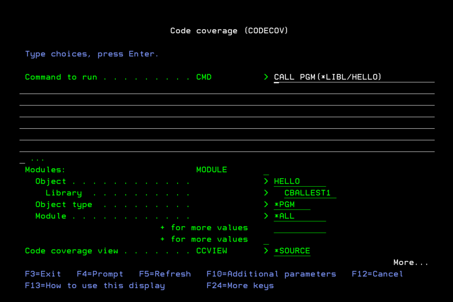
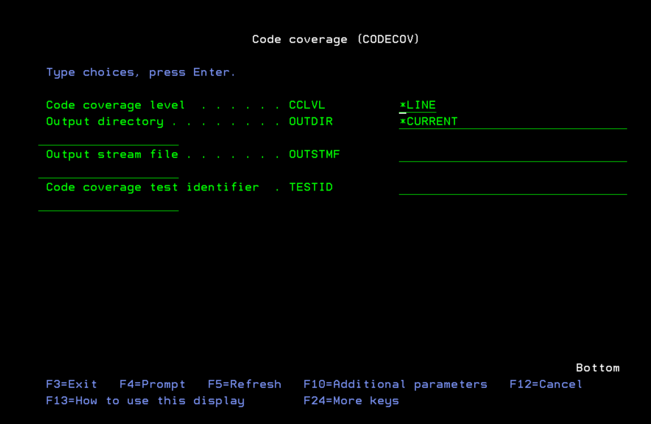
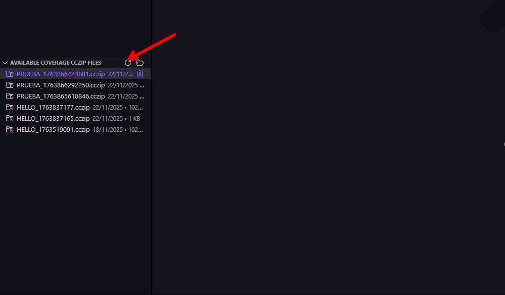
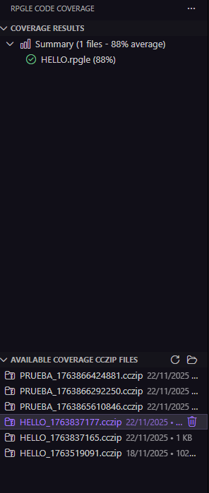

# Cobertura de Código RPGLE desde IBM i

Esta sección describe cómo ejecutar un análisis de cobertura de código RPGLE directamente desde un sistema IBM i utilizando el comando `CODECOV`. Este método es útil cuando únicamente se desea utilizar Visual Studio Code para generar el reporte de cobertura, pero no para ejecutar la cobertura.


1. **Configuración de librerias:** Agregue todas las librerias necesarias para la ejecución del componente que desea analizar. Asegúrate de que la libreria `QDEVTOOLS` esté en la lista de librerias de tu sesión IBM i, ya que contiene las herramientas necesarias para la cobertura de código. Si estás utilizando RPGUnit, también debes incluir la libreria `RPGUnit`.


2. **Ejecución de la Cobertura de Código:** Digite el comando `CODECOV` en la consola de IBM i, presione F4 y configure los siguientes parámetros:

   **Parámetro 1: Comando de Ejecución del Programa. el programa a ejecutar puede ser el mismo programa al que se le esta haciendo cobertura, un RPGUnit u otro programa como un CL.**
   ```
   Ejemplo: CALL PGM(MILIB/MIPGM)
   O: RUCALLTST TSTPGM(MILIB/MIPGM_TEST)
   ```

   **Parámetro 2: Programas/SRVPGM a Analizar**: Puede generar cobertura para múltiples programas o service programs en una sola ejecución. Especifique cada objeto en una nueva línea con el siguiente formato:
   ```
   Ejemplos:
   - MILIB/MIPGM    *PGM    *ALL
   - MILIB/MISRVPGM *SRVPGM *ALL
   - MILIB/MISRVPGM *SRVPGM MODULO1
   ```

3. **Vista de Cobertura: *Source vs *List:**

Seleccione la vista de depuración (*SOURCE o *LIST) para el análisis de cobertura de código. La vista *SOURCE solo cubrirá las sentencias que aparecen en el miembro fuente principal. Si las directivas /COPY o /INCLUDE incluyen sentencias ejecutables, la cobertura de dichas sentencias solo se detectará con la vista *LIST. Si su programa no contiene una vista *LIST, compílelo de nuevo con DBGVIEW(*ALL) o DBGVIEW(*LIST).

Si su programa se compiló solo con una vista de depuración *SOURCE, debe seleccionar solo *SOURCE. Si su programa se compiló solo con una vista de lista, debe seleccionar solo *LIST. Si su programa se compiló con todas las vistas de depuración, puede seleccionar *SOURCE o *LIST. Si su programa contiene SQL incrustado y lo compiló con DBGVIEW(*SOURCE), contendrá todas las vistas de depuración. De lo contrario, consulte la ayuda del parámetro DBGVIEW de su comando de compilación para averiguar qué vistas de depuración tiene su programa.

La vista de depuración *SOURCE necesita que el archivo fuente desde donde fue compilado el objeto esté disponible en la ubicación esperada. Si el archivo fuente se ha movido o eliminado, no sera posible ejecutar la cobertura con este vista de depuración.Sin embargo, la vista de depuración *LIST utiliza el código del objeto al momento de la compilación. Esta siempre estará disponible y se puede usar en su lugar.

En mi experiencia personal, la vista de depuración SOURCE es más precisa y recomiendo utilizarla siempre que este disponible. La vista de depuración *LIST puede llegar a ser menos precisa.

4. **Nivel de Cobertura: *LINE vs *PROC:** Determina la granularidad de la medición de cobertura.

**Opciones:**

| Opción | Descripción | Mejor Para |
|--------|-------------|------------|
| **\*LINE** | Mide cobertura por líneas ejecutadas | Uso general, análisis detallado |
| **\*PROC** | Mide cobertura por procedimientos ejecutados | Vista rápida, pruebas a nivel de procedimiento |

**Recomendación:** Usa `*LINE` para la mayoría de los casos.

5. **Ejecutar Cobertura**: Presione Enter para ejecutar el comando `CODECOV`. El sistema recopilará los datos de cobertura mientras se ejecuta el programa especificado.





6. **Recuperar Resultados**: Una vez que la ejecución haya finalizado, los resultados de cobertura se almacenarán en un archivo `.cczip` en la carpeta `home` del usuario que la ejecuto. 

7. **Visualizar Resultados en VS Code**:

   - Abre Visual Studio Code y navega a la extensión RPGLE Code Coverage.
   - Utiliza la opción para importar archivos `.cczip`.
   - Seleccione el icono refrescar para cargar los datos de la coberura recien ejecutada.

   

   - Seleccione el archivo generado en el paso anterior con un clic.
   - Visualiza los resultados de cobertura directamente en tu editor, con resaltado de líneas cubiertas y no cubiertas, y genera reportes profesionales en PDF o HTML.
   
   

### Comprender Tus Primeros Resultados

Después de ejecutar la cobertura, verás:

- **📊 Resumen**: Porcentaje de cobertura general y conteo de archivos
- **📄 Lista de Archivos**: Cada archivo analizado con su porcentaje de cobertura
- **🎨 Resaltado en el Editor**: 
  - 🟢 Verde = Líneas cubiertas
  - 🔴 Rojo = Líneas no cubiertas
- **📑 Reporte PDF**: Generado automáticamente en la carpeta `coverage-reports/`

## Siguientes Pasos

Ahora que has ejecutado tu primer análisis de cobertura, explora más:

**Siguiente:** [Configuración](configuracion.md) | [Solución de Problemas](solucion_de_problemas.md) | [Preguntas Frecuentes](faq.md) 

