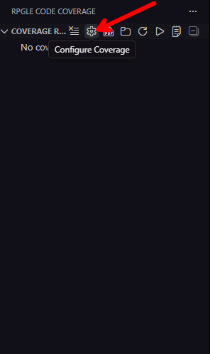
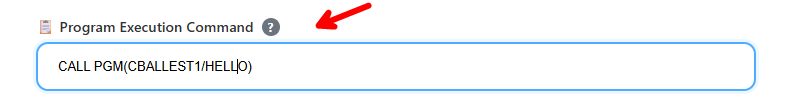
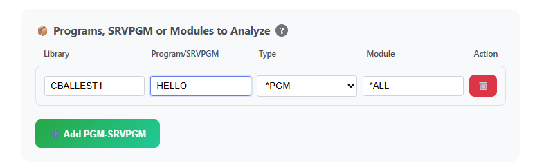
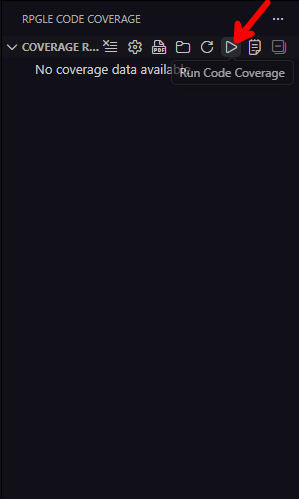
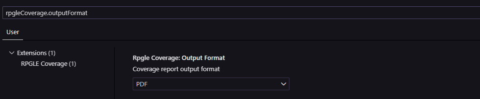
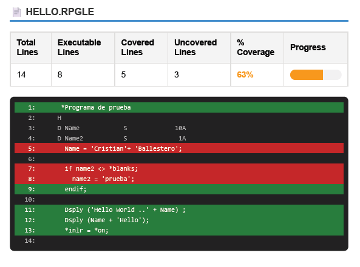
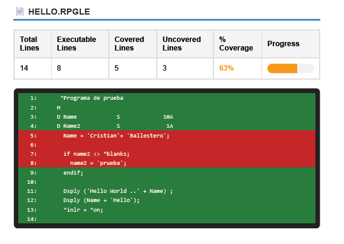
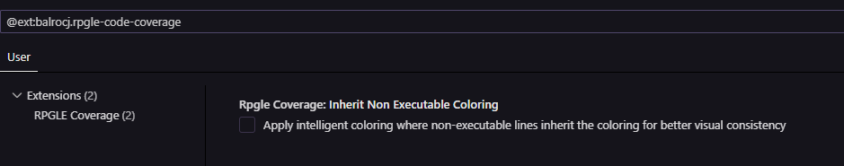

# Referencia de Configuración

Guía completa para configurar RPGLE Code Coverage.

## Métodos de Configuración

La extensión RPGLE Code Coverage cuenta con una interfaz visual para facilitar la configuración.
Existen dos métodos para obtener un reporte de cobertura de código con la extensión RPGLE Code Coverage:

1. **Desde Visual Studio Code** - Utilizando la Interfaz visual
2. **Desde el IBM i** - Utilzando el comando Codecov y leyendo el archivo de resultado cczip.

## Cobertura desde Visual Studio Code

Cuando se ejecuta la cobertura desde VS Code, se utiliza la la lista de librerias de la conexión activa de Code for IBM i. Es indispensable tener agregada la libreria QDEVTOOLS en la lista de librerias. Ya que la cobertura se genera utilizando herramientas que residen en dicha libreria. Si el programa a ejecutar es un RPGUnit, también es necesario tener agregada la libreria RPGUnit.

### Abrir el Panel

Haz clic en el ícono **⚙️ Engranaje de Configuración** en la vista de Resultados de Cobertura.



### Campos Requeridos

#### 1. Comando de Ejecución del Programa

El comando que ejecutará tu programa en IBM i.

**Formato:**
```
CALL PGM(LIBRERIA/PROGRAMA) [PARM('valor1' 'valor2')]
```
o
```
RUCALLTST TSTPGM(LIBRERIA/PROGRAMAPRUEBA)
```

**Ejemplos:**
```
CALL PGM(MILIB/INVOICE01)
CALL PGM(MILIB/CUSTPGM) PARM('12345')
RUCALLTST TSTPGM(TESTLIB/TEST_INVOICE)
CLPGM01 /* Tu propio CL que configura librerias */
```




**💡 Consejo:** Si el programa al que se le desea generar cobertura de código necesita muchas librerias para su ejecución, una opción es crear un programa CL personalizado para configurar tu lista de librerias:

```cl
PGM
   /* Configurar lista de librerias */
   ADDLIBLE LIB(QDEVTOOLS)
   ADDLIBLE LIB(TULIB)
   ADDLIBLE LIB(TULIB2)
   ADDLIBLE LIB(TULIB3)
   ADDLIBLE LIB(TULIB4)
   .
   .
   .
   
   /* Llamar a tu programa */
   CALL PGM(TULIB/TUPGM) PARM('param1') o RUCALLTST TSTPGM(TESTLIB/TEST_INVOICE)
ENDPGM
```

Luego usa: `CALL PGM(TULIB/CLPGM01)` como tu programa de ejecución. De esta forma puedes evitar utilizar la lista de librerias de la extensión Code For IBM i.

---

#### 2. Programas/SRVPGM a Analizar

Especifica qué objetos analizar para cobertura.

**Formato:**
```
LIBRERIA/NOMBRE_OBJETO *TIPO NOMBRE_MODULO
```

**Componentes:**
- **LIBRERIA**: Nombre de libreria de IBM i donde se ubica el programa o service program a analizar (máximo 10 caracteres)
- **NOMBRE_OBJETO**: Nombre de programa o service program (máximo 10 caracteres)
- **TIPO**: `*PGM` o `*SRVPGM`
- **NOMBRE_MODULO**: Módulo específico a probar o `*ALL`. Si usas `*ALL`, se analizarán todos los módulos del objeto. Cuando el tipo es`*PGM` siempre debe ser `*ALL`.

**Ejemplos:**

```
✅ Programa único (todos los módulos):
MILIB/MIPGM *PGM *ALL

✅ Service Program (todos los módulos):
MILIB/MISRVPGM *SRVPGM *ALL

✅ Service Program (módulo específico):
MILIB/MISRVPGM *SRVPGM MODULO1

```



**Agregar Múltiples Entradas:**
Haz clic en el botón **"➕ Agregar PGM-SRVPGM"** para agregar más objetos a analizar.

✅ Múltiples objetos:
MILIB/PGM1      *PGM    *ALL
MILIB/SRVPGM1   *SRVPGM *ALL
MILIB/SRVPGM2   *SRVPGM MODULO1
TESTLIB/TESTPGM *PGM    *ALL
---

### Opciones Avanzadas

#### 3. Vista de Cobertura: *Source vs *List

Seleccione la vista de depuración (*SOURCE o *LIST) para el análisis de cobertura de código. La vista *SOURCE solo cubrirá las sentencias que aparecen en el miembro fuente principal. Si las directivas /COPY o /INCLUDE incluyen sentencias ejecutables, la cobertura de dichas sentencias solo se detectará con la vista *LIST. Si su programa no contiene una vista *LIST, compílelo de nuevo con DBGVIEW(*ALL) o DBGVIEW(*LIST).

Si su programa se compiló solo con una vista de depuración *SOURCE, debe seleccionar solo *SOURCE. Si su programa se compiló solo con una vista de lista, debe seleccionar solo *LIST. Si su programa se compiló con todas las vistas de depuración, puede seleccionar *SOURCE o *LIST. Si su programa contiene SQL incrustado y lo compiló con DBGVIEW(*SOURCE), contendrá todas las vistas de depuración. De lo contrario, consulte la ayuda del parámetro DBGVIEW de su comando de compilación para averiguar qué vistas de depuración tiene su programa.

La vista de depuración *SOURCE necesita que el archivo fuente desde donde fue compilado el objeto esté disponible en la ubicación esperada. Si el archivo fuente se ha movido o eliminado, no sera posible ejecutar la cobertura con este vista de depuración.Sin embargo, la vista de depuración *LIST utiliza el código del objeto al momento de la compilación. Esta siempre estará disponible y se puede usar en su lugar.

En mi experiencia personal, la vista de depuración SOURCE es más precisa y recomiendo utilizarla siempre que este disponible. La vista de depuración *LIST puede llegar a ser menos precisa.

---

#### Nivel de Cobertura

Determina la granularidad de la medición de cobertura.

**Opciones:**

| Opción | Descripción | Mejor Para |
|--------|-------------|------------|
| **\*LINE** | Mide cobertura por líneas ejecutadas | Uso general, análisis detallado |
| **\*PROC** | Mide cobertura por procedimientos ejecutados | Vista rápida, pruebas a nivel de procedimiento |

**Recomendación:** Usa `*LINE` para la mayoría de los casos.

#### 4. **Guardar Configuración**
   - Haz clic en **"Guardar Configuración"**

#### 5. **Ejecutar Cobertura**
   - Haz clic en **"Ejecutar Cobertura de Código"** (ícono de play)
   - Espera a que el análisis se complete
   - Ver resultados en el panel de Resultados de Cobertura



## Configuración de variables globales 

### Configuración Global de la Extensión

Abre la Configuración de VS Code (`Ctrl+,`) y busca "RPGLE Code Coverage".

#### Formato de Salida

**Configuración:** `rpgleCoverage.outputFormat`

**Opciones:**
- `PDF` (predeterminado) - Generar reportes PDF. Si la generación de PDF falla, se generará un reporte HTML como respaldo.
- `HTML` - Generar reportes HTML



#### Coloración Inteligente

**Configuración:** `rpgleCoverage.inheritNonExecutableColoring`

**Tipo:** Boolean (true/false)

**Predeterminado:** `false`. Se colorea el reporte de cobertura de la forma tradicional (Similar a RDi).

**Descripción:** Cuando está habilitado, las líneas no ejecutables (comentarios, líneas en blanco) tambien se colorean. De esta forma no quedan líneas sin color en el reporte de cobertura, lo que puede mejorar la consistencia visual. **Esto no afecta el porcetaje de cobertura, ni la cantidad de líneas ejecutadas, solo afecta la apariencia del reporte.**

**Ejemplo:**

// Con inheritNonExecutableColoring = false




// Con inheritNonExecutableColoring = true




**Recomendación:** Mantener `false` para comportamiento tradicional, habilitar para consistencia visual.




## Resumen

### ✅ Hacer

- **Probar con un programa simple primero** antes de configuraciones complejas
- **Usar vista *SOURCE** cuando sea posible para precisión
- **Mantener archivos de configuración en control de versiones**
librerias
### ❌ No Hacer

- **No usar *LIST** a menos que el fuente no esté disponible
- **No analizar módulos innecesarios** (rendimiento)
- **No olvidar QDEVTOOLS** en tu lista de librerias
- **No modificar archivos .cczip** manualmente

---

**Siguiente:** [Cobertura desde IBM i](cobertura_desde_ibm_i.md) | [Solución de Problemas](solucion_de_problemas.md) | [Preguntas Frecuentes](faq.md) | [Configuración](configuracion.md)

