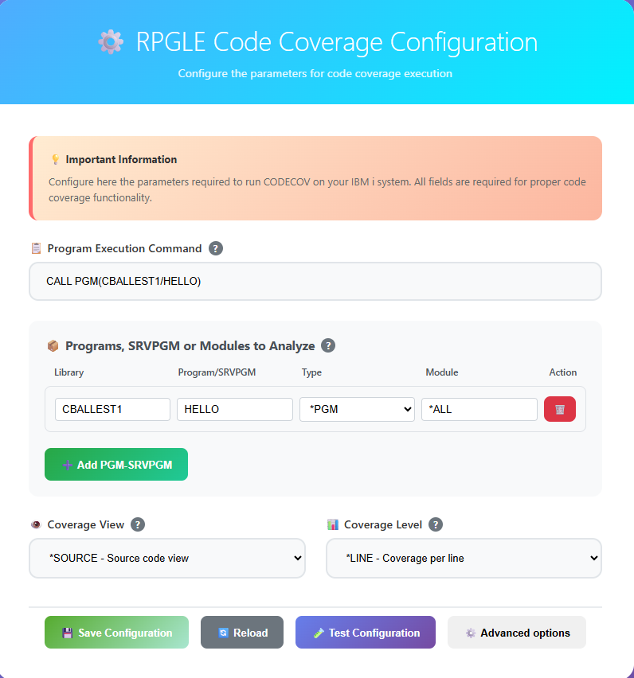
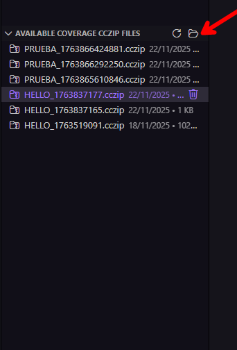
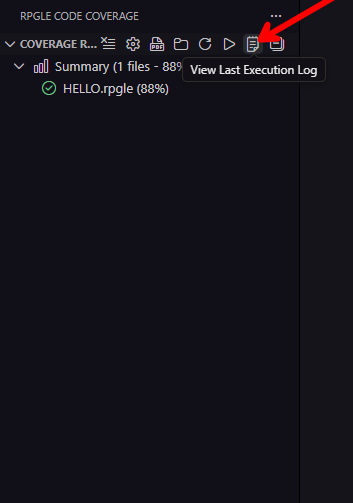

# Descripción de Características

Guía completa de todas las características disponibles en la extención RPGLE Code Coverage.

## 🎯 Características Principales

### Análisis de Cobertura de Código en Tiempo Real

Ejecuta análisis de cobertura de código directamente desde VS Code con integración perfecta con IBM i.

**Beneficios Clave:**
- ✅ Ejecución en vivo en IBM i
- ✅ Recopilación automática de resultados
- ✅ Sin transferencias manuales de archivos
- ✅ Integración con Code for IBM i

**Cómo Usar:**
1. Configura tu programa y módulos


2. Haz clic en **"Ejecutar Cobertura de Código"** (▶️)


3. Espera a que el análisis se complete
4. Ver resultados en tiempo real

### Resultado Visual de Cobertura de Código

Ve los resultados de cobertura directamente en tu editor de código fuente.

**Código de Colores:**
- 🟢 **Fondo Verde** - La línea fue ejecutada (cubierta)
- 🔴 **Fondo Rojo** - La línea no fue ejecutada (no cubierta)
- ⚪ **Sin Color** - Línea no ejecutable (comentario, declaración)

**Características:**
- **Regla de Vista General**: Marcadores de colores en la barra de desplazamiento
- **Actualizaciones Instantáneas**: La cobertura se aplica automáticamente al abrir archivos
- **Visualización Persistente**: La cobertura permanece visible al navegar por el código
- **Soporte Multi-Archivo**: Funciona en todos los archivos analizados


### Generación de Reportes Profesionales

Genera reportes de cobertura completos en formato PDF o HTML.

#### Reportes PDF

**Características:**
- 📄 Calidad lista para publicación
- 📊 Gráficos y estadísticas embebidos
- 🎨 Código con resaltado de sintaxis
- 📁 Organizado por componente
- 🔍 Métricas detalladas de cobertura

**Auto-Generación:** Los reportes se crean automáticamente después de cada ejecución de cobertura.

#### Reportes HTML

**Características:**
- 🌐 Abre en cualquier navegador
- 📱 Diseño responsivo 
- 🔍 Contenido buscable
- 💾 Fácil de compartir
- ⚡ Generación más rápida que PDF

**Cambiar Formatos:**
```
Configuración > RPGLE Code Coverage > Formato de Salida
Elegir: PDF o HTML
```

---

### Vista de Árbol de Cobertura

Visualización jerárquica de todos los resultados de cobertura en la barra lateral.

**Estructura:**
```
📊 Resumen (2 archivos - 75% promedio)
  ├── 📄 INVOICE01.RPGLE (85%) ✅
  └── 📄 CUSTUTILS.RPGLE (65%) ⚠️
```

**Iconos:**
- ✅ **Marca Verde** - Cobertura ≥ 80%
- ⚠️ **Advertencia Amarilla** - Cobertura 50-79%
- ❌ **X Roja** - Cobertura < 50%

**Interacciones:**
- **Clic en archivo** - Abre fuente con resaltado de cobertura
- **Hover** - Muestra tooltip detallado con estadísticas

---

### Procesar Archivos de Cobertura Existentes

Importa y analiza archivos .cczip pregenerados sin volver a ejecutar la cobertura.

**Casos de Uso:**
- ✅ La cobertura ya se ejecutó en IBM i
- ✅ Analizando datos históricos de cobertura
- ✅ Compartiendo resultados de cobertura entre equipos

**Dos Métodos:**

#### Método 1: Desde Directorio Home de IBM i
1. Haz clic en **"Refrescar Archivos Disponibles"** (🔄)


2. Ver lista de archivos .cczip en tu directorio home
3. Haz clic en archivo para procesar
4. Los resultados se cargan automáticamente


#### Método 2: Desde una carpeta en tu computadora personal
1. Haz clic en **"Seleccionar Archivo de Cobertura Local"** (📂)



2. Navega a tu archivo .cczip
3. Selecciona el archivo
4. Los resultados se cargan automáticamente

---

### Panel de Configuración

Interfaz de configuración moderna basada en web.

**Características:**
- 🎨 UI limpia e intuitiva
- ✅ Validación de campos
- 💡 Tooltips de ayuda contextual
- 🔄 Botones de Guardar/Cargar/Probar
- ⚙️ Opciones avanzadas

**Secciones:**

1. **Ejecución de Programa** - Comando para ejecutar tu programa
2. **Módulos a Analizar** - Configuración de Programas/Service Programs
3. **Opciones Avanzadas** - Configuración de vista y nivel de cobertura
4. **Acciones** - Guardar, Cargar, Probar, Configuración Avanzada

---

### Integración con IBM i

Integración profunda con la extensión Code for IBM i.

**Detección Automática:**
- ✅ Estado de conexión activa
- ✅ Configuración de lista de librerias
- ✅ Manejo de URI de miembros
- ✅ Acceso a archivos fuente

**Validación de librerias:**
- Verifica QDEVTOOLS
- Valida librerias requeridas
- Advierte sobre dependencias faltantes
- Sugiere soluciones

---

### Registro de Ejecución

Registro completo de todas las operaciones de cobertura.

**Panel de Salida:**
- Ver progreso en tiempo real
- Ver detalles de ejecución de comandos
- Monitorear procesamiento de archivos
- Rastrear errores y advertencias

**Logs de la ejecución:** Solo disponible cuando se ejecuta la cobertura desde VS Code.

**Niveles de Log:**
- ℹ️ **INFO** - Operaciones normales
- ⚠️ **WARNING** - Problemas no críticos
- ❌ **ERROR** - Fallos de operación
- 🐛 **DEBUG** - Información de diagnóstico detallada

**Log de Última Ejecución:**
- Haz clic en el botón **"Ver Log de Última Ejecución"**
- Abre log formateado de la ejecución de cobertura más reciente
- Útil para solución de problemas, por ejemplo detectar librerias faltantes
- Muestra salida del comando 




### Historial de Cobertura

Rastrea la cobertura a lo largo del tiempo (vía archivos de reporte).

**Marcación de Tiempo Automática:**
```
coverage-report-2024-11-28-143052.pdf
coverage-report-2024-11-28-150123.pdf
coverage-report-2024-11-29-091545.pdf
```

**Beneficios:**
- Comparar tendencias de cobertura
- Documentar progreso de pruebas
- Archivar para cumplimiento
- Rastrear mejoras

## 🎨 Características de Interfaz de Usuario

### Integración con Barra de Actividad

Ícono dedicado de RPGLE Code Coverage en la Barra de Actividad.

**Visibilidad:**
- Solo se muestra cuando está conectado a IBM i
- Se integra con el estado de conexión de Code for IBM i
- Interfaz limpia y ordenada

---

### Integración con Paleta de Comandos

Todos los comandos disponibles vía Paleta de Comandos (`Ctrl+Shift+P`).

**Comandos Disponibles:**
```
RPGLE Code Coverage: Run Code Coverage
RPGLE Code Coverage: Clear Coverage
RPGLE Code Coverage: Generate Report
RPGLE Code Coverage: Configure Coverage
RPGLE Code Coverage: Open Reports Folder
RPGLE Code Coverage: Refresh Available Files
RPGLE Code Coverage: Select Local Coverage File
RPGLE Code Coverage: View Last Execution Log
```

---

## 📈 Características de Reportes

### Métricas de Cobertura

Estadísticas detalladas en reportes:

**Métricas por Archivo:**
- Total de líneas en archivo
- Conteo de líneas ejecutables
- Conteo de líneas cubiertas
- Conteo de líneas no cubiertas
- Porcentaje de cobertura
- Visualización de barra de progreso

**Métricas de Resumen:**
- Total de archivos analizados
- Cobertura promedio
- Estadísticas generales

---

**Relacionado:** [Cobertura desde Visual Studio](cobertura_desde_visual_studio.md) | [Cobertura desde IBM i](cobertura_desde_ibm_i.md) | [Preguntas Frecuenes](faq.md) | [Solución de Problemas](solucion_de_problemas.md)
