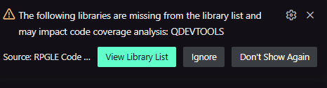
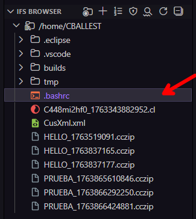
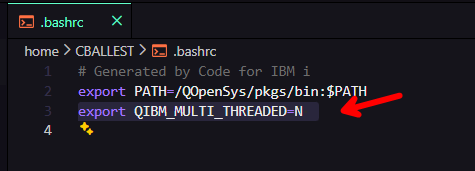

# Guía de Mensajes de Error

Comprender y resolver mensajes de error en RPGLE Code Coverage.

## 🚨 Errores de Conexión

### "No se pudo establecer conexión con IBM i"

**Mensaje Completo:**
```
ERROR: A connection to IBM i could not be established. Verify that Code for IBM i is connected.
```

**Significado:** La extensión no puede conectarse a tu sistema IBM i a través de Code for IBM i.

**Soluciones:**
1. Instala Code for IBM i si no está presente
2. Verifica el estado de conexión en la barra de estado
3. Haz clic en el nombre de conexión y selecciona "Connect"
4. Intenta desconectar y reconectar
5. Reinicia VS Code si el problema persiste

---

## 🔧 Errores de Configuración

### "Configuración inválida"

**Mensaje Completo:**
```
ERROR: programToExecute is required in the codecov configuration. Please configure the program execution command.
```
**Significado:** La configuración para ejecutar la cobertura de código en visual studio code no es valida..

**Soluciones:**
1. Abre el Panel de Configuración (ícono ⚙️)
2. Ingresa la configuración requerida
3. Haz clic en "Guardar Configuración"
4. El archivo se creará automáticamente

---

### "Error al intentar ver el log de la última ejecución"

**Formato Correcto:**
```
ERROR: 📋 No execution log available. Run coverage analysis first to see execution details.```
```
**Significado:** No hay un log de ejecución disponible para mostrar.


**Solucion:**
1. La visualización del log requiere que se haya ejecutado un análisis de cobertura previamente, desde Visual Studio Code.
2. No es posible ver el log si se ha ejecutado la cobertura desde IBM i o si no se ha ejecutado ninguna cobertura aún.
3. Ejecuta un análisis de cobertura primero
4. Luego intenta ver el log nuevamente 

---

### "Error al intentar ver el log de la última ejecución"

```
ERROR: The following libraries are missing from the library list and may impact code coverage analysis: QDEVTOOLS
```
**Significado:** La libreria QDEVTOOLS no está en la lista de librerias de tu sesión actual en IBM i.

**Soluciones:**

**Opción 1: Agregar a la Lista de librerias**
```
Configuración de Code for IBM i > Conexión > Lista de librerias
Agregar: QDEVTOOLS
```



**Opción 2: Programa CL Personalizado**: Si el programa a ajecutar es un CL que hace su propia gestión de librerias, agrega QDEVTOOLS al CL:
```cl
PGM
   ADDLIBLE LIB(QDEVTOOLS)
   ADDLIBLE LIB(MILIB)
   CALL PGM(MILIB/MIPGM)
ENDPGM
```

---

### "Errores durante la ejecución de cobertura"

**Mensaje:**
```
Error: Coverage is in progress; however, errors occurred during the process. 
This is likely due to missing libraries. Please wait for the report to be generated, then review the library list and try again.
```
Significado:** Durante la ejecución de la cobertura se detectaron errores que generalmente están relacionados con objetos no encontrados en la lista de librerias. Este mensaje es informativo y no detiene la ejecicón de la cobertura..

**Soluciones:**
1. Revisa la lista de librerias para asegurarte de que todas las necesarias estén incluidas.
2. Agrega cualquier libreria faltante a la configuración de Code for IBM i.
3. Revise el log de ejecución para detalles específicos sobre los objetos no encontrados. Esto es el equivalente a las anotaciones de trabajo en el IBM i.


### "Covertura no disponible en un trabajo multihilo"

```
ERROR: STRDBG command not allowed in thread capable job.
```

**Significado:** Este mensaje de error se prensenta cuando el usuario de IBM i intenta ejecutar la cobertura en un trabajo multihilo (thread capable job). El comando CODEVCOV utiliza STRDBG internamente, y este comando no es compatible con trabajos multihilo. 


**Solucion:**
1. Utilizando la extensión Code for IBM i, busque en la carpeta home de usuario un archivo llamado `.bashrc`.



2. Abra el archivo `.bashrc` y agregue la siguiente línea al final del archivo:
   ```
   export QIBM_MULTI_THREADED=N 
   ```



3. Guarde los cambios y cierre el archivo.
4. Cierre y vuelva a abrir Visual Studio Code para que los cambios surtan efecto.
5. Intente ejecutar la cobertura nuevamente.


---

**Relacionado:** [Configuración](configuracion.md) | [Preguntas Frecuentes](faq.md) 
